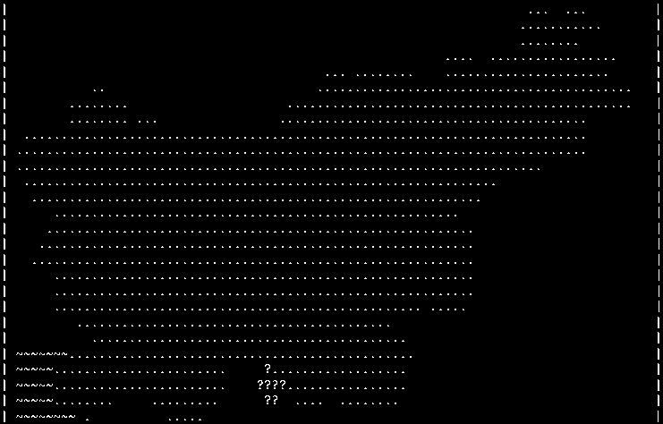

```
               \/
  ___  ____   ____ ___ _   _ _____
 / _ \| __ ) / ___|_ _| \ | | ____|
| | | |  _ \| |    | ||  \| |  _|
| |_| | |_) | |___ | || |\  | |___
 \___/|____/ \____|___|_| \_|_____|
```

A text-mode idle clicker about Slovenia's 212 municipalities (občine).
Ring the church bell, build an economy, and unlock every občina from the
smallest (Osilnica, 326 people) to the largest (Ljubljana, ~303,000).
Black and white, one font, one character grid. Slovenian and English.

**Play:** https://collarcore.github.io/improved-disco/




## How it plays

- **Zvonik**: click the bell (or press space) for tolarji. Five bell upgrades, each with its
  own sound, from a small handbell to *pritrkavanje* to the bells of every parish.
- **Proizvodnja**: 12 producers, from *njiva* to *elektrarna*. New ones open as you unlock more občine.
  `*` marks the best price for the income.
- **Občine**: unlock them in order of population. Every resident adds to your income
  (1 resident = +0.005 %), and finishing a statistical region gives ×1.25.
- **Znamenitosti**: 44 municipalities carry a landmark upgrade, such as Idrija's mercury mine,
  Krško's power plant, Planica in Kranjska Gora or kremšnita in Bled.
- **Kurent**: shows up on the map now and then. Catch him for a ×7 boost, a pustni krof or a click frenzy.
- **Referendum**: prestige. Reset your run for votes (each +5 % income for good) and adopt one of
  12 **constitutional amendments**: cheaper producers, a more frequent Kurent, the first 25 občine free, and so on.
- **Prazniki**: seasonal events from the real calendar: Pust and Prešernov dan in February,
  Dan državnosti in June, the tourist season, trgatev, Martinovanje in November, Christmas, the ski season.
- **Dosežki**: 53 achievements, each +1 %. One of them is a secret.

The game saves in your browser and earns at half speed while closed (up to 8 h).
Settings → *Prenos igre* copies the save so you can continue on another device.

## How long it takes

Two simulations, both in `tools/`:

| who | all 212 | referendums |
|---|---|---|
| perfect bot, playing nonstop (`sim_prestige.py`) | ~24.5 h of play | 3 |
| 3 visits a day, 10 min each, calls a referendum past ~150 občin | ~9 days | 4 |
| the same player, never calling a referendum | ~15 days | 0 |

Neither model includes the Kurent, achievements, amendments or events, which all speed things up.
Each referendum vote is +5 % income, so calling one late in a run pays off for active and casual
players alike; the game says so in the *next občina* panel when the moment is right.

## Playtesting

Settings → *kopiraj statistiko* copies a short report: total time with the page open,
calendar days since the first start, and when each milestone (10, 25, 50 … 212 občin,
every referendum) was reached. Testers can paste it into a message. Nothing is sent anywhere by the game.

## Accessibility

The ASCII art, the map and the big counter are hidden from screen readers. Instead there is
a text summary (balance, income, next občina and its cost), panel titles are headings, buttons
carry plain labels, new log entries are announced, and a hidden button lets screen-reader
users catch the Kurent. Animations stop under *prefers-reduced-motion*.

## Files

| path | what |
|---|---|
| `index.html` | the whole game, built (open it directly, no server needed) |
| `src/game.html` | page shell: markup and CSS |
| `src/game.js` | the game; every string is a `tr('slovensko','English')` pair |
| `data/obcine.json` | name, population, area, founding year, region, coordinates |
| `data/maps.json` | the ASCII maps (84 and 44 columns), one cell → one občina |
| `tools/build.py` | fills the shell with the game, data and maps → `index.html` |
| `tools/mapgen.py` | regenerates the maps from coordinates (weighted Voronoi) |
| `tools/econ.py`, `tools/sim.py` | one-run balance simulation with a greedy bot |
| `tools/sim_prestige.py` | full campaign with referendums |
| `tools/sim_casual.py` | calendar days for players who only look in now and then |
| `fonts/` | IBM Plex Mono, self-hosted |
| `docs/` | README images |

Rebuild after editing: `python3 tools/build.py`

Saves carry a version number (`v`). When the save format changes, bump `VERSION` in
`src/game.js` and add a step to `migrate()` so older saves are upgraded instead of broken.

## Hosting

GitHub Pages → *Deploy from a branch* → `main`, folder `/ (root)`.

## Licence

Code: MIT, see `LICENSE`. Data: derived from Wikipedia
([Seznam občin v Sloveniji](https://sl.wikipedia.org/wiki/Seznam_ob%C4%8Din_v_Sloveniji) and the
English articles on each municipality), CC BY-SA 4.0. The map is an approximation built from each
municipality's seat, not real borders. Font: IBM Plex Mono, SIL Open Font License 1.1.
