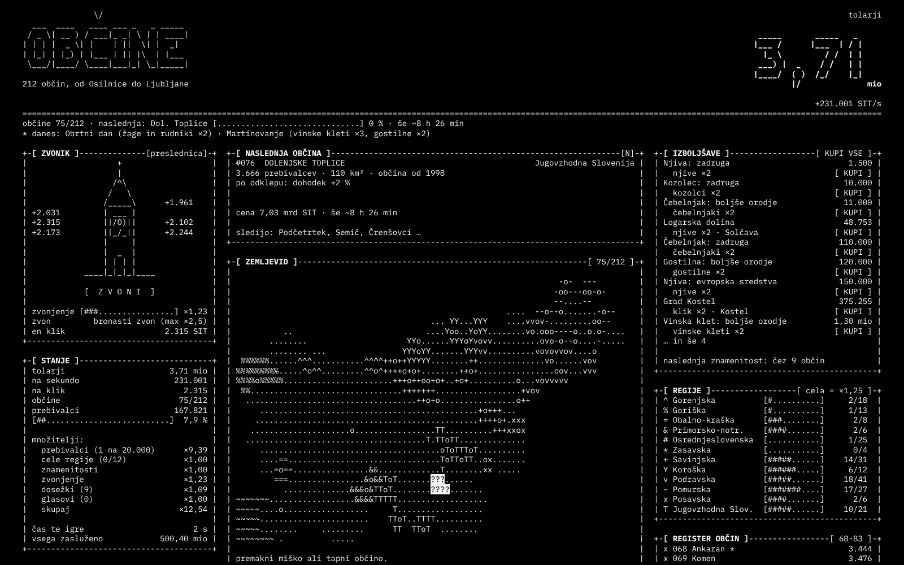

```
               \/
  ___  ____   ____ ___ _   _ _____
 / _ \| __ ) / ___|_ _| \ | | ____|
| | | |  _ \| |    | ||  \| |  _|
| |_| | |_) | |___ | || |\  | |___
 \___/|____/ \____|___|_| \_|_____|
```

A text-mode idle clicker about Slovenia's 212 municipalities (občine).
Ring the church bell, build an economy, and unlock every občina from the
smallest (Osilnica, 326 people) to the largest (Ljubljana, ~303,000).
Black and white, one font, one character grid. Slovenian and English.

**Play:** https://collarcore.github.io/improved-disco/




## How it plays

- **Zvonik**: click the bell (or press space) for tolarji. Ringing fills the **zvonjenje** meter,
  which multiplies *all* income while you keep ringing: ×1.5 with the handbell, up to ×5 with
  the bells of every parish. It drains when you pause, so active play matters all game.
  Five bell upgrades, each with its own sound, from a small handbell to *pritrkavanje*.
  Ringing on a full meter banks time (1 s per ring, up to 10 min): stop, and the meter stays full while the bank
  runs down.
  Up to 10 rings a second pay (about a fast mouse finger), so drumming on a phone or an autoclicker
  gains nothing over a mouse; faster taps still ring.
- **Proizvodnja**: 12 producers, from *njiva* to *elektrarna*. New ones open as you unlock more občine.
  `*` marks the best price for the income.
- **Občine**: unlock them in order of population. Every resident adds to your income
  (1 resident = +0.005 %), and finishing a statistical region gives ×1.25.
- **Map links**: hovering (or tapping) a row in the register highlights that občina on the map;
  a region row lights up its unlocked občine and makes the rest of the region blink.
- **Znamenitosti**: 44 municipalities carry a landmark upgrade, such as Idrija's mercury mine,
  Krško's power plant, Planica in Kranjska Gora or kremšnita in Bled.
- **Zmaj in jadrnica**: now and then the Dragon Bridge dragon flies across the header, and a sailboat crosses the sea
  on the map. Each has its own sound; catching them is a second way to two of the secrets.
- **Found secrets stay**: the dragon then lives in the header, gliding to and fro, and the boat lies at anchor; Triglav gets its M on the
  map, a seagull circles the coast, a flag flies on the belfry, and the bells ring noon by themselves.
- **Kurent**: shows up on the map every 4–8 minutes for 13 seconds. Catch him for ×3 income (30 s),
  a pustni krof worth 3 minutes of income, or clicks ×7 (10 s). A pop-up says what you got. A nice bonus, not an engine.
- **Referendum**: prestige. Reset your run for votes (each +5 % income for good) and adopt one of
  three **constitutional amendments** drawn from a pool of 20: cheaper producers, a more frequent Kurent, the first 25 občine
  free, a night shift, doubled holiday bonuses, a 30-minute ringing bank, and so on. Every run picks a different path.
- **Teden**: every weekday has its own bonus from village life: tržni dan (Monday), obrtni dan,
  delavnik, izletniki, petek v gostilni, gasilska veselica and nedeljska maša (Sunday: the meter fills twice as fast).
- **Prazniki**: rarer extras from the real calendar: Pust and Prešernov dan in February,
  Dan državnosti in June, the tourist season, trgatev, Martinovanje in November, Christmas, the ski season.
- **Dosežki**: 61 achievements, each +1 %. Seven are secrets, shown as ??? with a cryptic hint until you find them;
  each secret has its own drawing, as do every weekday, holiday and bell upgrade.
- **Listina**: unlocking Ljubljana turns the next-municipality panel into a certificate with your time,
  rings, Kurents, referendums and secrets found, and a button that copies the result to share.

The game saves in your browser and earns at half speed while closed (up to 8 h).
Settings → *Prenos igre* copies the save so you can continue on another device.

## How long it takes

From `python3 tools/balance.py` (models producers, landmarks, bells, the ringing meter,
the week and referendums; leaves out the Kurent, achievements, amendments and holidays,
so real players are somewhat faster):

| občine | active player (hours of play) | casual player, 3×10 min a day (days) |
|---|---|---|
| 10 | 0.8 | 0.9 |
| 25 | 2.4 | 1.5 |
| 50 | 5.2 | 2.5 |
| 100 | 7.6 | 3.5 |
| 150 | 12.4 | 6.5 |
| all 212 | ~28 (8 referendums) | ~17 (6 referendums) |

Without referendums a run stalls around 150 občin; the *next občina* panel says when one pays off.

## Playtesting

Settings → *kopiraj statistiko* copies a short report: total time with the page open,
calendar days since the first start, and when each milestone (10, 25, 50 … 212 občin,
every referendum) was reached. Testers can paste it into a message. Nothing is sent anywhere by the game.

## Accessibility

The ASCII art, the map and the big counter are hidden from screen readers. Instead there is
a text summary (balance, income, next občina and its cost), panel titles are headings, buttons
carry plain labels, new log entries are announced, and a hidden button lets screen-reader
users catch the Kurent. Animations stop under *prefers-reduced-motion* (a hovered region is underlined
instead of blinking). On touch screens double-tap zoom is off, so fast taps all ring, while pinch-zoom
stays for anyone who needs bigger text; a tap that lands just off a button still counts.

## Files

| path | what |
|---|---|
| `index.html` | the whole game, built (open it directly, no server needed) |
| `src/game.html` | page shell: markup and CSS |
| `src/game.js` | the game; every string is a `tr('slovensko','English')` pair |
| `data/obcine.json` | name, population, area, founding year, region, coordinates |
| `data/maps.json` | the ASCII maps (84 and 44 columns), one cell → one občina |
| `tools/build.py` | fills the shell with the game, data and maps → `index.html` (comments stripped with terser, if installed) and `version.json` |
| `tools/mapgen.py` | regenerates the maps from coordinates (weighted Voronoi) |
| `tools/econ.py` | game data for the simulator |
| `tools/balance.py` | balance simulator: active and casual players, prices in one place |
| *(cheating)* | the game runs in a closure and checks its own money; unearned tolarji earn the belfry a permanent dunce cap |
| `tools/shots.py` | renders the README screenshot and the link-preview image from the game |
| `fonts/` | IBM Plex Mono, self-hosted |
| `docs/` | README images |
| `tests/` | browser tests (see `tests/README.md`) |

Rebuild after editing: `python3 tools/build.py` (`npm i -g terser` first, so the shipped page carries no comments)

Saves carry a version number (`v`). When the save format changes, bump `VERSION` in
`src/game.js` and add a step to `migrate()` so older saves are upgraded instead of broken.

## Hosting

GitHub Pages → *Deploy from a branch* → `main`, folder `/ (root)`.

## Thanks

Aiken tested the game's defences the way only a determined friend would: an edited save, a console script that
rewrote the save and blocked the game's own saving, and finally a debugger breakpoint. Each round closed a real
hole, and his scripts are now part of the tests (`tests/console_script.py`, `tests/cheats.py`).

## Licence

Code: MIT, see `LICENSE`. Data: derived from Wikipedia
([Seznam občin v Sloveniji](https://sl.wikipedia.org/wiki/Seznam_ob%C4%8Din_v_Sloveniji) and the
English articles on each municipality), CC BY-SA 4.0. The map is an approximation built from each
municipality's seat, not real borders. Font: IBM Plex Mono, SIL Open Font License 1.1.
